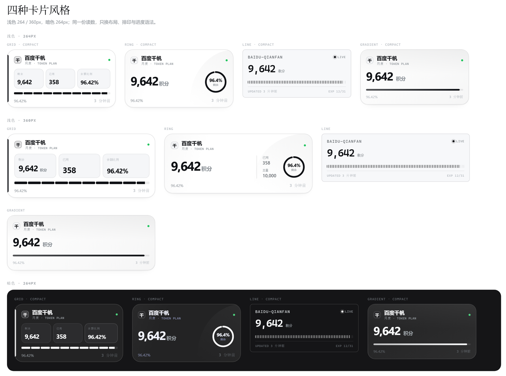
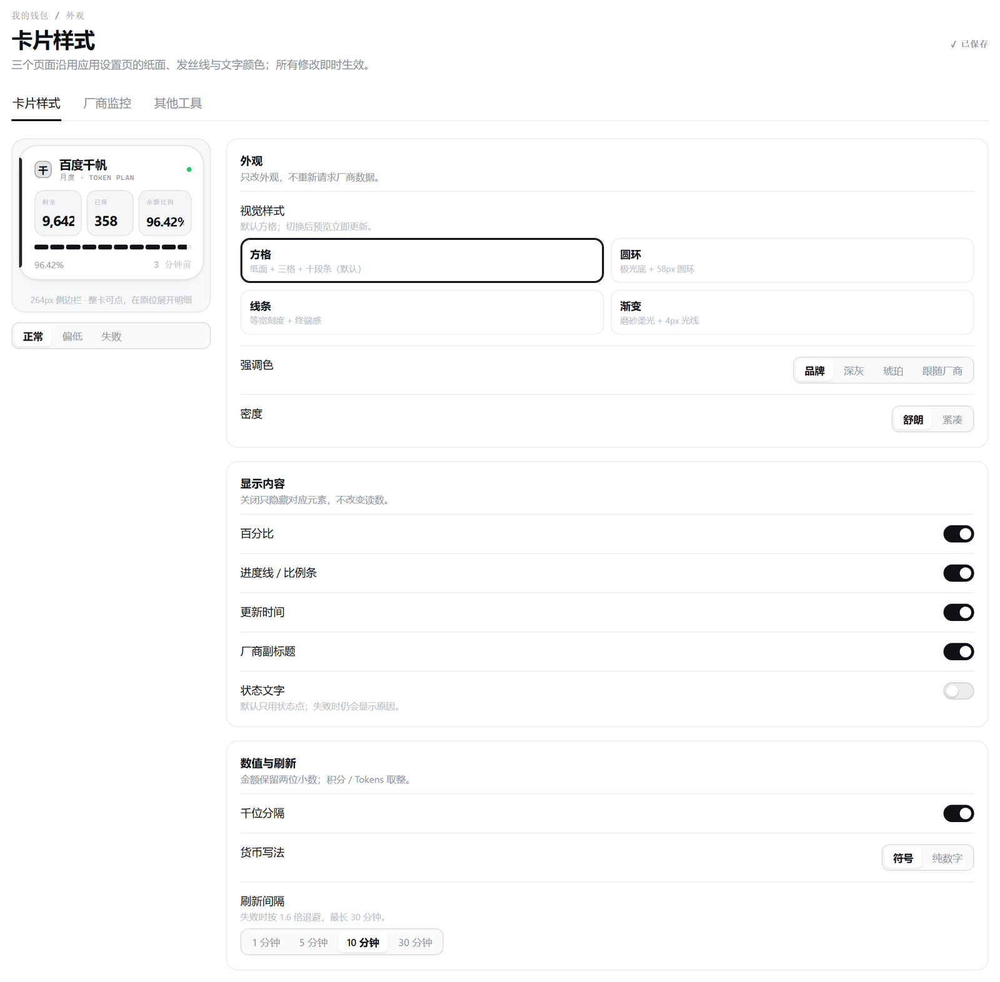
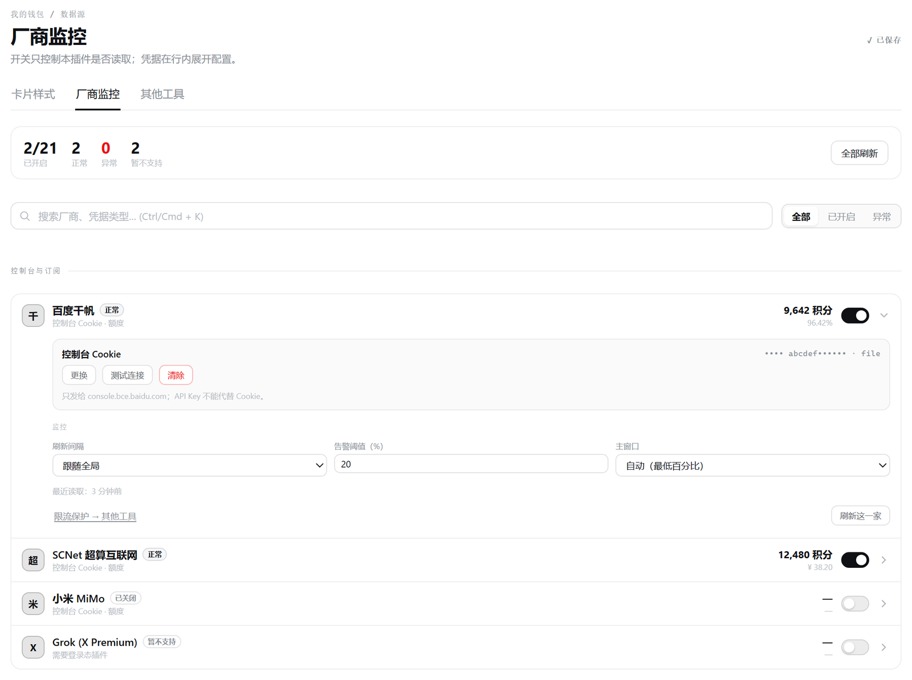
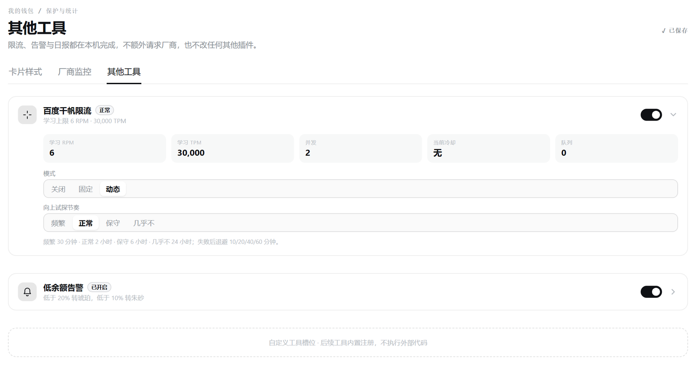

# dsh-balance-card 2.0

**把当前会话模型背后厂商的余额与额度，做成 dsh Web 侧边栏里的一张卡片。**

自包含：只依赖 DSH 的 `credentials` 与 `connection`，不调用任何其他插件、不读其他插件的环回路由。四种卡片风格、三页设置、21 家厂商直连都在本插件内闭环。

[](https://github.com/Utmotc/dsh-balance-card/releases)
[](LICENSE)
[](https://github.com/topics/dsh-plugin)



切换模型，卡片跟着换厂商；点击卡片在原位展开明细，不跳页面。设置里有三页：**卡片样式 / 厂商监控 / 其他工具**。







## 功能

- **跟随当前模型。** 优先读会话的 `modelSelection` 投影，其次请求事件、DSH 默认模型；`baiduqianfanlyq` 这类自定义路由也能映射到同一家厂商。
- **四种风格。** 方格（默认）/ 圆环 / 线条 / 渐变；同一份读数四种画法，切换风格不重新请求、不改数字。
- **三页设置。** 卡片样式 / 厂商监控 / 其他工具；主题不提供选项，始终跟随 DSH 软件明暗。
- **每家一个开关。** 行开关只表示「本插件是否监控这家」；关闭后不再发请求，保留凭据与设置。开关即时生效，不需要刷新。
- **21 家厂商直连。** API Key、控制台 Cookie、OAuth Token、AK/SK、自定义 HTTPS 五种接入方式；Grok / Copilot 明确暂不支持。
- **凭据只进 DSH 凭据库。** 浏览器只拿到归一化读数、单位、状态与错误码；测试连接也不回显明文。
- **错误诚实。** 未配置、登录过期、限流、超时、解析失败分别给不同的下一步；失败不伪造 0。
- **千帆限流。** 关闭 / 固定 / 动态；四档向上试探节奏（频繁 / 正常 / 保守 / 几乎不），默认正常。
- **金额型不画无效进度。** 没有预算时隐藏空进度条，改为放大金额；有总量的额度与积分照常显示比例。

## 安装

要求 **dsh 0.1.7 或更新**，Node **22.19+**（或 24+）。

> 2.0 目前以 GitHub 标签为安装源。npm 上的 1.x 包不会自动变成 2.0；如果需要 npm 安装，请先按「发布 npm」一节自行发布 2.0。

### 终端安装（推荐）

```bash
dsh plugin --profile <profile> add https://github.com/Utmotc/dsh-balance-card/archive/refs/tags/v2.0.0.tar.gz
```

把 `<profile>` 换成实际使用的 profile，例如 `desktop` 或 `web`。

### Web 界面安装

打开 dsh Web 侧边栏的**插件页**，把同一条 GitHub 标签地址粘贴进安装框并确认。

### 本地开发

```bash
dsh plugin --profile desktop add "link:/absolute/path/to/dsh-balance-card"
```

Host 代码改动后重启 dsh；只改浏览器半边时刷新页面即可。

### 升级

重新安装新标签：

```bash
dsh plugin --profile <profile> add https://github.com/Utmotc/dsh-balance-card/archive/refs/tags/v2.0.0.tar.gz
```

升级不会清除 `balance-settings-v2.json`、凭据或限流状态。

## 三页设置

入口：**设置 → 我的钱包**。

### 卡片样式

| 分组 | 控件 |
|---|---|
| 外观 | 视觉样式（方格 / 圆环 / 线条 / 渐变）、强调色（品牌 / 深灰 / 琥珀 / 跟随厂商）、密度（舒朗 / 紧凑） |
| 显示内容 | 百分比、进度线、更新时间、厂商副标题、状态文字 |
| 数值与刷新 | 千位分隔、货币写法（符号 / 纯数字）、刷新间隔（1 / 5 / 10 / 30 分钟） |
| 交互 | 点击卡片（展开明细 / 打开设置）、在侧边栏显示卡片 |

主题没有选项，始终跟随 DSH 软件的明暗切换。左侧预览为 208px，右侧控制列占满剩余宽度；窄屏自动上下堆叠。

### 厂商监控

顶部只有一句说明，搜索（Ctrl/Cmd + K）与「全部 / 已开启 / 异常」过滤；分组为控制台与订阅 / 官方 API / 自定义 / 更多厂商。

每行：字母章 + 厂商名 + 状态 + 凭据类型；右侧读数、百分比、行开关、展开箭头。展开后：

- 凭据：掩码 + 更换 / 测试连接 / 清除（二次确认）；复用 DSH 官方 Key 时显示「DSH」并隐藏清除。
- 监控：刷新间隔、告警阈值、主窗口、余额基准（仅金额型）。
- 高级：端点覆盖、JSON 路径、算式、单位、Workspace ID / Org ID / Account ID、允许私有网段。
- 最近读取与错误说明；底部「限流保护 → 其他工具」。

### 其他工具

1. **百度千帆限流**：关闭 / 固定 / 动态，三档预设、安全系数、四档试探节奏、路由明细、重置学习值。
2. **低余额告警**：阈值、临界阈值、安静时段；通知服务不可用时降级为卡片变色。
3. **用量日报**：本地快照差分，按天汇总；到点生成一份昨日摘要。
4. **自定义工具槽位**：首版为虚线空槽，后续内置注册，不执行外部代码。

## 四种卡片风格

| 名称 | id | 布局 | 表面 | 进度语法 | 默认 |
|---|---|---|---|---|---|
| **方格** | `grid` | 纸面 + 三格（剩余 / 已用 / 余额比例） | 白色卡面 + 3px 状态书脊，暗色 `#232324` | 10 段比例条 | 是 |
| **圆环** | `ring` | 左金额 + 中「已用 / 总量」+ 右 58px 环 | 白色卡面 + 中性大圆角波浪，暗色 `#232324` | 环形百分比 | 否 |
| **线条** | `line` | 表头 + 金额 + 刻度 + hairline 表尾 | 浅灰纸 + 1px 硬边框，暗色 `#151517` | 34 格刻度 | 否 |
| **渐变** | `gradient` | 表头 + 金额 + 柔光进度线 | 中性磨砂 + 18px 圆角 | 4px 发光渐变线 | 否 |

- 264px 为紧凑形态，360px 为完整形态，56px 窄栏退化为 40×40 图标格。
- 颜色使用 DSH 设置页同源的中性 alias 值：浅色白底 + 近黑，暗色 `#151517` / `#232324` / `#F9FAFB`。
- 金额型且没有预算时隐藏进度：方格单行大金额、圆环隐藏环、线条隐藏刻度、渐变隐藏光带。
- `prefers-reduced-motion` 下只保留透明度变化。

## 厂商矩阵

| # | 分组 | 厂商 | 凭据 | 读数 | 状态 |
|---|---|---|---|---|---|
| 1 | 控制台 | 百度千帆 Token Plan | 控制台 Cookie | 积分 / Tokens，月度 + 到期 | 稳定 |
| 2 | 控制台 | SCNet 超算互联网 | 控制台 Cookie | Credits + ¥ | 稳定 |
| 3 | 控制台 | 小米 MiMo | 控制台 Cookie | Tokens + 余额 | 实验性 |
| 4 | 控制台 | 智谱 GLM / Z.ai | Coding Plan Key | 5 小时 / 周 | 实验性 |
| 5 | 控制台 | 火山方舟 | IAM AK/SK | 5 小时 / 周 / 月 | 实验性 |
| 6 | 控制台 | 千问 Qwen | 控制台 Cookie / 端点覆盖 | 月度 | 实验性 |
| 7 | 控制台 | Claude Pro / Max | OAuth Token | 5 小时 / 7 天 | 实验性 |
| 8 | 控制台 | ChatGPT / Codex | Codex Token | 5 小时 / 周 | 实验性 |
| 9 | 控制台 | Google Antigravity | 本机 Token | 各模型独立 | 实验性 |
| 10 | 控制台 | Grok (X Premium) | – | – | **暂不支持** |
| 11 | 控制台 | GitHub Copilot | – | – | **暂不支持** |
| 12 | API | DeepSeek | `DEEPSEEK_API_KEY` | ¥ | 稳定 |
| 13 | API | StepFun | `STEPFUN_API_KEY` | ¥ | 稳定 |
| 14 | API | Kimi / Moonshot | `KIMI_API_KEY` | 次 / ¥ | 稳定 |
| 15 | API | OpenRouter | `OPENROUTER_API_KEY` | $ | 稳定 |
| 16 | API | MiniMax | `MINIMAX_API_KEY` | 次 / % | 稳定 |
| 17 | API | xAI / Grok API | `XAI_API_KEY` | $ | 稳定 |
| 18 | API | SiliconFlow 硅基流动 | `SILICONFLOW_API_KEY` | ¥ | 稳定 |
| 19 | 自定义 | 自定义余额接口 | 自定义 Header / Key | 任意 | 稳定 |
| 20 | 更多 | OpenDesign | Control Key / Cookie | Credits | 实验性 |
| 21 | 更多 | Factory (Droid) | `FACTORY_API_KEY` | 5 小时 / 周 / 月 | 实验性 |
| 22 | 更多 | CommandCode | `COMMANDCODE_API_KEY` | 5 小时 / 周 / 月 | 实验性 |
| 23 | 更多 | Cline Pass | `CLINE_PASS_API_KEY` | 5 小时 / 周 / 月 | 实验性 |

「实验性」= 接口非公开或可能随厂商版本变化；失败只影响这一家，其他厂商不受影响。

## 凭据

密钥 / Cookie / Token 只存在 DSH 凭据库；普通设置写在插件自己的 `balance-settings-v2.json`。浏览器永远不接触明文。

**复用 DSH 官方配置**：API Key 类厂商会额外读取 `llm-pi-ai.providers.<route>.apiKeyEnv` 与 `llm-deepseek-api-key.apiKeyEnv`。本插件没有单独凭据时直接使用同一份 Key，行内标「DSH」。只适用于「账单接口接受同一把 Key」的厂商（DeepSeek / StepFun / Kimi / OpenRouter / MiniMax / xAI / SiliconFlow 等）。

控制台 Cookie、OAuth、AK/SK、本机登录态**不会**自动复用：能调用模型不代表同一凭据能查余额。例如百度千帆 / SCNet / 小米的推理 Key 读不了控制台 Token Plan。

| 厂商 | 凭据引用 |
|---|---|
| DeepSeek | `DEEPSEEK_API_KEY` |
| StepFun | `STEPFUN_API_KEY` |
| Kimi | `KIMI_API_KEY`（或 `KIMI_CODING_API_KEY`） |
| OpenRouter | `OPENROUTER_API_KEY` |
| MiniMax | `MINIMAX_API_KEY` |
| xAI | `XAI_API_KEY` |
| SiliconFlow | `SILICONFLOW_API_KEY` |
| 百度千帆 | `BAIDU_QIANFAN_COOKIE` |
| SCNet | `SCNET_COOKIE` |
| 小米 MiMo | `MIMO_COOKIE` |
| 智谱 | `ZAI_API_KEY`（或 `BIGMODEL_API_KEY`） |
| 火山方舟 | `VOLC_ACCESSKEY` + `VOLC_SECRETKEY` |
| 千问 | `QWEN_COOKIE` |
| Claude | `ANTHROPIC_OAUTH_TOKEN` |
| ChatGPT / Codex | `OPENAI_CODEX_API_KEY` |
| Antigravity | `ANTIGRAVITY_TOKEN` |
| OpenDesign | `OPENDESIGN_CREDENTIAL` |
| Factory | `FACTORY_API_KEY` |
| CommandCode | `COMMANDCODE_API_KEY` |
| Cline Pass | `CLINE_PASS_API_KEY` |
| 自定义 | `CUSTOM_BALANCE_KEY`（可选） |

## 安全边界

- 浏览器响应里没有 Key / Cookie / 原始响应；诊断与错误消息都脱敏。
- 所有厂商请求集中走 `lib/net.js`：只允许 HTTPS、手动 3xx 不跟随、15 秒超时、1 MB 上限。
- 自定义接口默认只允许公网 HTTPS；私有网段必须显式开启（防 SSRF）。
- 自定义算式只接受数字、`value` 与四则运算，不执行任意代码。
- 设置文件原子写（临时文件 + rename），写入串行化。
- 所有路由走 Connection 的鉴权 `/api` 通道，不注册未鉴权的 `webServer` 路由。
- 不读其他插件目录、不调用其他插件路由、不依赖任何 npm 包。

## Host 路由

| 方法 | 路径 | 用途 |
|---|---|---|
| GET | `/api/dsh-balance-card/v2/snapshot` | 设置 + 厂商目录 + 全部读数 |
| GET | `/api/dsh-balance-card/v2/providers` | 厂商目录与凭据状态 |
| POST | `/api/dsh-balance-card/v2/settings` | 设置补丁（原子写） |
| POST | `/api/dsh-balance-card/v2/refresh` | 手动刷新（单家或全部） |
| POST | `/api/dsh-balance-card/v2/credentials` | 保存凭据 |
| POST | `/api/dsh-balance-card/v2/credentials/test` | 只测试，不保存 |
| POST | `/api/dsh-balance-card/v2/credentials/clear` | 清除凭据 |
| GET/POST | `/api/dsh-balance-card/v2/tools` | 工具状态与设置 |
| GET | `/api/dsh-balance-card/v2/throttle/status` | 限流状态 |
| POST | `/api/dsh-balance-card/v2/throttle/reset` | 重置学习值 |
| GET | `/api/dsh-balance-card/v2/export` | 导出设置（不含密钥） |
| POST | `/api/dsh-balance-card/v2/import` | 导入设置 |
| GET | `/api/dsh-balance-card/v2/diagnostics` | 脱敏诊断 |

缓存：成功按刷新间隔；失败 1.6 倍退避（上限 30 分钟）；401/403 等用户改凭据；失败保留上次成功值并标「缓存」；页面隐藏时停止轮询。

## 数据文件

| 文件 | 位置 | 内容 |
|---|---|---|
| `balance-settings-v2.json` | `$DSH_HOME/dsh-balance-card/` | 普通设置（不含密钥） |
| `balance-settings.v1.backup.json` | 同上 | 迁移前的 1.x 设置备份 |
| `throttle-state.json` | 同上 | 千帆限流学习状态 |
| `daily-usage.json` | 同上 | 用量日报快照 |

`$DSH_HOME` 默认 `~/.dsh`；可用行配置 `settingsFile` / `throttleStateFile` 指定。

## 从 1.x 迁移

首次启动 2.0：

1. 读 `balance-settings.json`，另存 `balance-settings.v1.backup.json`；
2. 写 `balance-settings-v2.json`；
3. 旧设置迁移：
   - `placement` → `card.visible`；
   - `visualStyle`：`instrument → line`、`glass → gradient`、`tile → ring`，未知 → `grid`；
   - `accentColor` → `accent`；白色 → 品牌；
   - `pollMs` / `warnPercent` / `showUpdatedAt` / `groupDigits` / `unitStyle` → 对应卡片字段；
   - `providers.*` → `vendors.<id>.enabled`（`kimi-coding → kimi`；WorkBuddy / Qoder / OrcaTerm / cost-meter / MobileClaw 丢弃）；
   - `throttle*` → `tools.qianfanThrottle.*`。
4. 旧凭据引用不变；旧 `throttle-state.json` 继续使用。

迁移失败不写新文件，卡片退安全默认，设置页显示失败原因与备份路径。

回滚：重新安装旧版本标签，并指回旧设置文件。

## 常见问题

**卡片显示「当前厂商未监控」？**
当前 provider route 没有映射到厂商。检查该厂商是否已在「厂商监控」开启；自定义路由（如 `baiduqianfanlyq`）会按受控前缀匹配到同一家。

**卡片显示「未配置凭据」？**
展开该厂商粘贴凭据，点「保存并测试」。控制台类需要 Cookie，推理 API Key 不能代替。

**为什么有些厂商标「实验性」？**
额度接口不是公开 API（OAuth / 控制台内部接口），可能随厂商版本失效；失败只影响这一家。

**金额型为什么不显示进度条？**
没有总量或预算时，百分比没有意义。插件会隐藏空进度并放大金额；设置预算后才会出现比例。

**换风格会重新请求吗？**
不会。四种风格共享同一份读数。

## 开发与测试

```bash
node test/host.test.mjs      # 24 项
node test/client.test.cjs    # 23 项
node test/throttle.test.mjs
node test/scnet.test.mjs
node test/bench-throttle.mjs # 可选
```

新增厂商：

1. 在 `lib/vendors/` 加纯读取函数，返回 `parse.js` 的统一读数或抛 `VendorError`；
2. 在 `lib/vendors/index.js` 登记；
3. 在 `lib/registry.js` 加定义（分组、别名、凭据引用、单位、批次、状态）；
4. 补 fixture 测试。

浏览器半边是单文件 bundle `lib/client.js`；样式在同一文件的 `CSS` 数组。截图由 `ui-proposals/v2-ink/build-plugin-preview.cjs` 从真实 CSS 生成。

## 发布 npm（可选）

市场收录不依赖 npm；发布后可显示下载量。2.0 需要单独发布：

```bash
npm publish --access public
```

发布包的 `repository` 必须指回 `https://github.com/Utmotc/dsh-balance-card`，否则市场不会关联。

## 版本

- **2.0.0** — 自包含重写：四种风格、三页设置、21 家厂商、v2 路由、旧设置迁移、官方 API Key 复用；删除全部依赖插件与输入框胶囊。
- **1.4.0** — 旧版：WorkBuddy / Qoder / OrcaTerm / cost-meter / subscriptions 依赖桥接。

## 许可

MIT。`LICENSE-dsh-model-balance` 保留上游 MIT 声明。